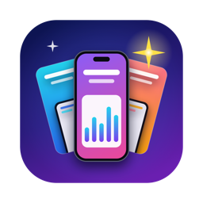
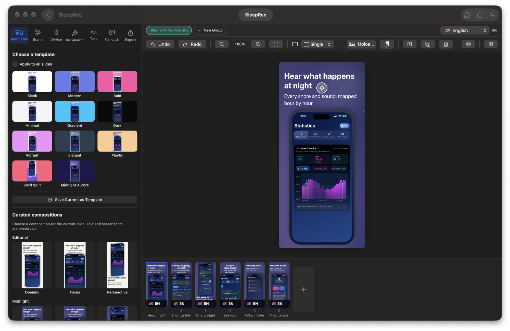
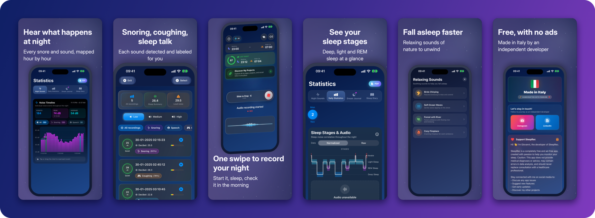
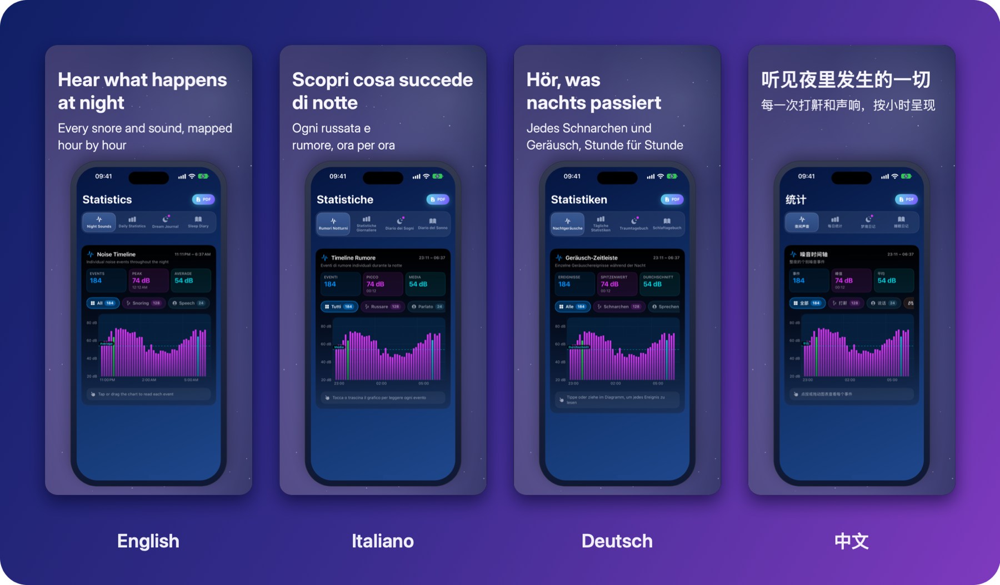
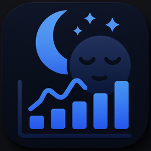

# ScreenShotJoe

<p align="center">
  
</p>

<h3 align="center">ScreenShotJoe</h3>

<p align="center">
  <b>Free, native App Store and Google Play screenshot maker for Mac — mockups, headlines and every store size in minutes.</b>
</p>

<p align="center">
  <a href="https://github.com/joemockdao/ScreenShotJoe/releases/latest">
    
  </a>
  
  
  
  
  <a href="https://github.com/joemockdao/ScreenShotJoe/releases">
    
  </a>
  <a href="https://github.com/joemockdao/ScreenShotJoe/stargazers">
    
  </a>
</p>

<p align="center">
  <a href="https://github.com/joemockdao/ScreenShotJoe/releases/latest">
    
  </a>
</p>

---

ScreenShotJoe turns raw screenshots of your app into polished store images: device mockups, backgrounds and headlines, exported at the exact pixel sizes each store requires, in every language you ship — all running locally on your Mac.

You can also let your own AI agent (Claude Code, Codex, Cursor and more) build the deck for you, and watch every change happen live in the app. [Learn more ↓](#-work-with-your-ai-agent)



> [!NOTE]
> **Free & ad-free:** ScreenShotJoe is a personal, independent project. No subscriptions, no watermarks, no ads, no account required.

<p align="center">
  ⭐ If ScreenShotJoe is useful to you, <a href="https://github.com/joemockdao/ScreenShotJoe/stargazers">starring the repo</a> helps other people find it.
</p>

---

## 🔒 Trust & Security (Apple Notarized)

* **Signed & Notarized**: Every release is signed with a valid Apple **Developer ID** and notarized by Apple, so it opens without security warnings on macOS.
* **On-Device Processing**: Rendering and export run entirely on your Mac, inside the macOS App Sandbox — your screenshots are never uploaded anywhere, and the app can only open the files and folders you choose. Text translation runs on-device through Apple's Translation framework. No account, no analytics, no tracking.
* **AI Agents Stay Local**: The AI agent connection is off until you switch it on. It only accepts connections from your own Mac (never from the network), every request needs a secret key that only you can copy, and agents can read and write only the folders you share with them. Keep in mind that your agent may send what it reads from the project (for example texts or a preview of a slide) to its own AI service, under that service's terms.
* **Closed-Source Notice**: This repository hosts precompiled releases only — the source code is private.

---

## ✨ Features

A complete App Store deck, made with ScreenShotJoe for **[SleepRec](https://apps.apple.com/app/sleeprec/id1528754113)**, a free sleep-tracking app for iPhone by the same developer:



* **Device mockups** for iPhone 17 / 17 Pro Max / 16 / 15, iPhone Duo, iPad, Pixel 8 Pro, generic Android phones and tablets, MacBook and Windows PC, in realistic, clay or minimal style, with optional 3D tilt.
* **Backgrounds**: solid, linear or radial gradient, split color or image, with overlays and decorative patterns.
* **Headlines and subtitles** with automatic line wrapping, a free-position text block, a bubble card and other text effects.
* **Extras**: floating trust badges and rating cards, a hero feature list, and a magnified detail of the screenshot.
* **Multi-device layouts**: single, dual or triple devices in one image, and panoramic sets that span several screenshots.
* **12 content languages** (English, Italian, German, French, Spanish, Portuguese, Japanese, Korean, Chinese, Arabic, Greek, Russian), each with its own texts and, optionally, its own screenshots, plus on-device translation.
One deck, every language — headlines and localized screenshots for each market:



* **Exact export sizes** for the App Store (iPhone, iPad, Mac, Apple TV, Apple Vision Pro, Apple Watch) and Google Play, as PNG, JPEG or ZIP. A `fastlane` folder layout is available for automated uploads.
* **Store readiness check** that flags missing sizes, wrapping problems, low contrast and untranslated copy before you export.
* **Store listing text** (name, subtitle, keywords, description and more) per language, saved with the project.
* **Templates and art directions** to restyle a whole deck in one click, with full undo/redo.

## 🤖 Work with your AI agent

ScreenShotJoe can be driven by AI agents through a local [MCP](https://modelcontextprotocol.io) server: the agent imports screenshots, writes and translates headlines, applies a style, reviews the result and exports, while every change appears live in the app and can be undone with ⌘Z.

* Turn it on in **Settings → AI agents**, which shows a ready-made configuration for Claude Code, Codex, OpenCode, Antigravity, Gemini CLI, Cursor, VS Code, Claude Desktop and other MCP clients.
* Share a folder with agents (for example your app's `fastlane` folder) to let them import from it and export straight into it.

## 💻 Requirements

* macOS 15 (Sequoia) or later, on Apple silicon or Intel.
* App interface in English and Italian.

## 📦 Install

1. Download `ScreenShotJoe-1.0.dmg` from the [latest release](https://github.com/joemockdao/ScreenShotJoe/releases/latest).
2. Open the disk image and drag **ScreenShotJoe** to **Applications**.
3. Launch it from Applications.

To verify the download (optional), put the `.sha256` file next to the disk image and run:

```bash
shasum -a 256 -c ScreenShotJoe-1.0.dmg.sha256
```

## 💬 Feedback

Found a bug or have an idea? Please open an [issue](https://github.com/joemockdao/ScreenShotJoe/issues).

## 🧩 Other apps by Joe

<table>
  <tr>
    <td align="center" width="33%">
      <a href="https://github.com/joemockdao/CleanMacJoe"><br><b>CleanMacJoe</b></a><br>
      <sub>Disk cleaner, duplicate finder &amp; app uninstaller for Mac</sub>
    </td>
    <td align="center" width="33%">
      <a href="https://github.com/joemockdao/Klipzen"><br><b>Klipzen</b></a><br>
      <sub>Native video editor for Mac</sub>
    </td>
    <td align="center" width="33%">
      <a href="https://apps.apple.com/app/sleeprec/id1528754113"><br><b>SleepRec</b></a><br>
      <sub>Record and understand your sleep sounds — free for iPhone</sub>
    </td>
  </tr>
</table>

## 📄 License

ScreenShotJoe is free to download and use, for personal and commercial projects. The screenshots and images you create with it are yours.

You may not redistribute, sell or modify the app, or reverse engineer it. The source code is private; this repository hosts precompiled releases only.

ScreenShotJoe is provided "as is", without warranty of any kind. The author is not liable for any damage arising from its use.

© 2026 Giovanni Trenta
